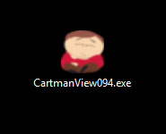
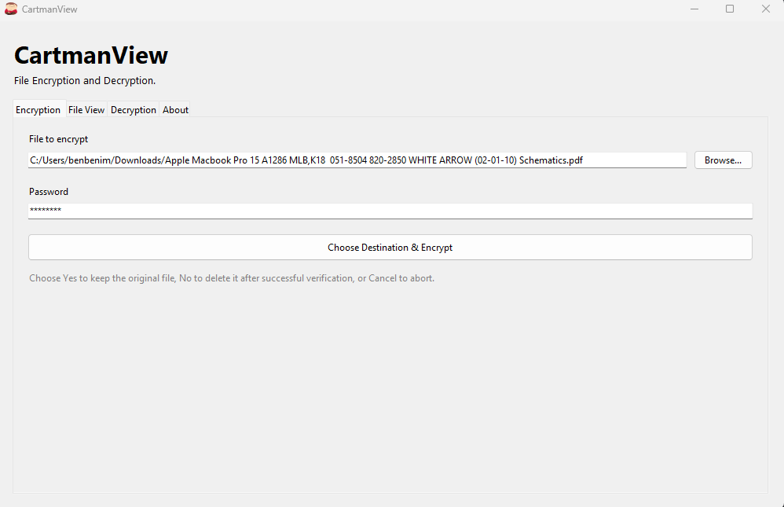
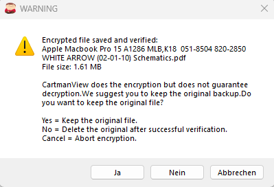
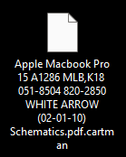
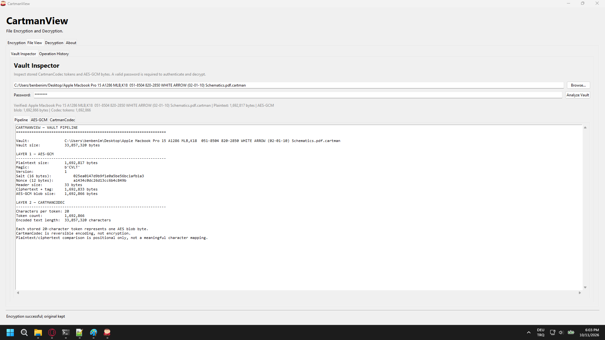
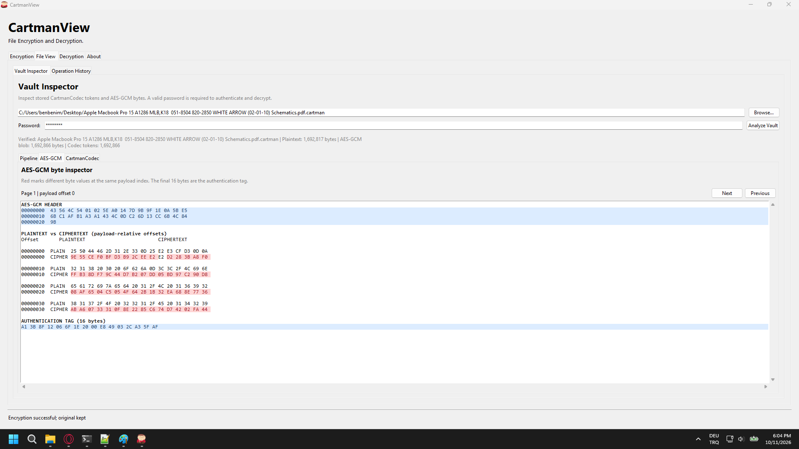
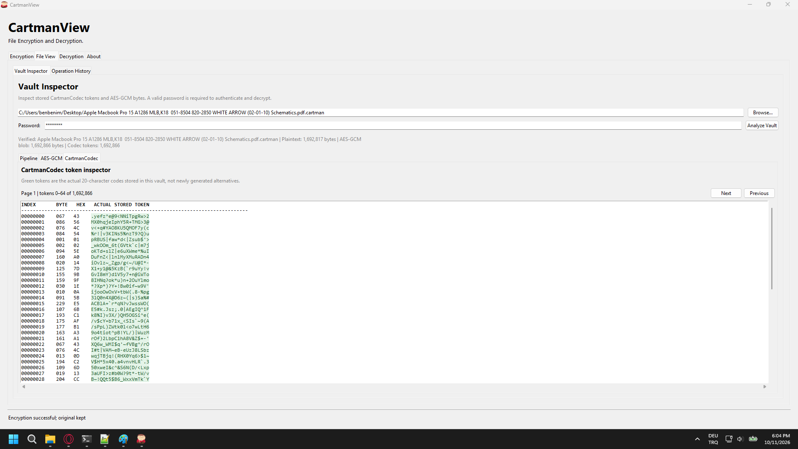
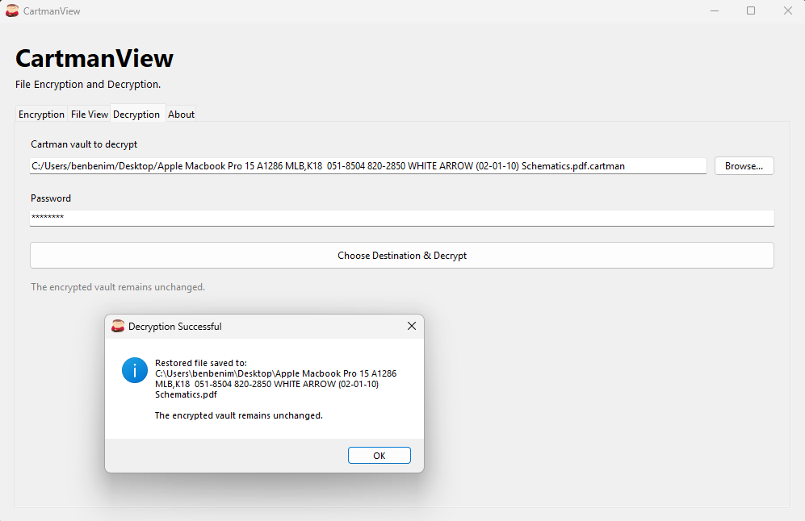
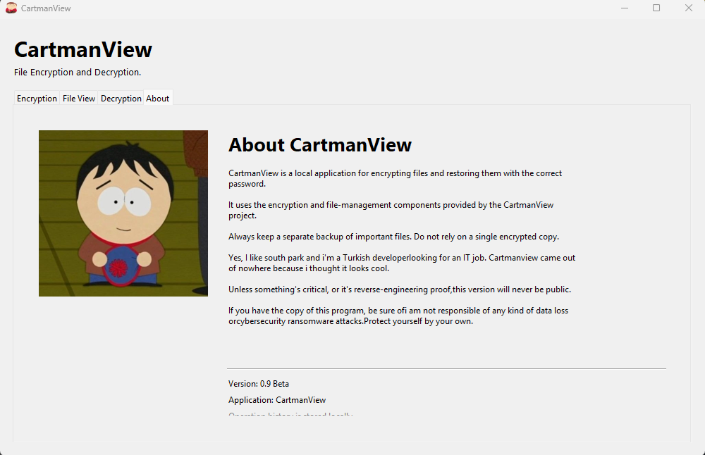
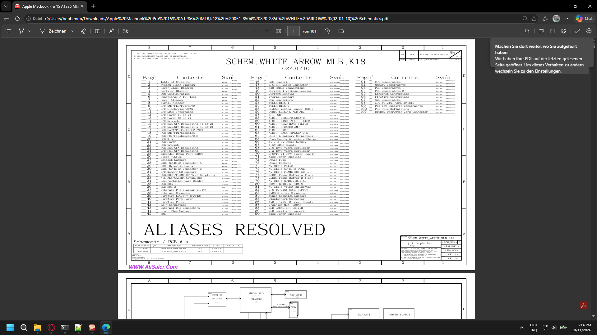

# CartmanView

**A standalone Windows application for encrypted file handling.**

CartmanView is a desktop application designed to encrypt files into a custom `.cartman` format and restore them through a dedicated graphical interface. This project showcases the application's workflow, from file selection and encryption to encrypted file inspection and decryption.

## 📦 1. Standalone Executable

CartmanView is packaged as a standalone Windows executable, designed to run from a single `.exe` file without requiring the user to manage the application's individual source files.



## 🔐 2. Encryption Overview

The Encryption screen is the application's default view and the starting point for the encryption workflow. Users can select a file and initiate the process through the graphical interface.



### ⚠️ 2.1 File Selection & Warning

After a file is selected, CartmanView displays a warning before proceeding. This gives users an opportunity to review the operation before continuing.



### 🖼️ 2.2 Encrypted File Verification

This demonstration follows an example JPEG image through the encryption process.

The original image is opened before encryption. After the encryption operation, the original file is removed from its previous location as part of the demonstrated workflow. An attempt to open the resulting `.cartman` container in a standard image viewer fails because the container is not a regular JPEG image.

The encrypted file must be processed through CartmanView's decryption workflow to restore the original image.



## 📂 3. File View

The File View section presents the file-processing workflow through three distinct areas: the processing pipeline, AES-GCM, and CartmanCodec.

### 3.1 Processing Pipeline

The pipeline illustrates how file data moves through the encryption and encoding stages before being stored in the custom container format.

```text
Original File
     │
     ▼
AES-GCM Encryption
     │
     ▼
CartmanCodec Encoding
     │
     ▼
.cartman Container
```



### 3.2 AES-GCM

AES-GCM provides authenticated encryption, protecting file contents and allowing the application to verify the integrity of encrypted data during decryption.



### 3.3 CartmanCodec

CartmanCodec handles the custom encoding layer used by CartmanView. It transforms the encrypted payload into the representation stored in a `.cartman` container and decodes that representation during restoration.

Encoding and encryption serve different purposes. The custom format does not replace the underlying cryptographic protection.

The codes you see will not be enough for you to understand how lettering works, each letter has it's own 20 different versions. The codes mathematically can't be same. :=)



## 🔓 4. Decryption

The Decryption screen provides the interface for selecting a `.cartman` container and restoring its contents.

During restoration, the container is decoded and the encrypted payload is authenticated and decrypted. Successful restoration requires the correct password and valid encrypted data.



## ℹ️ 5. About

The About section presents the application's identity and descriptive information through its dedicated interface.



## 📥 6. Distribution

The standalone Windows executable can be published through the repository's [Releases](../../releases) section.

This repository serves as a showcase for the application and its graphical interface. The application source code is not publicly included.

The time i am sure the program is reverse engineering proof, i will share the .exe file.


Here's the catch.

I will upload the .cartman file, the original extension .pdf .  If you can crack it and decrypt it, please feel free to share the decrypted file. It should look like this:



Here's the file.

[Dosyayı görüntüle](macbook_schema.pdf)

Good luck.

Let me know the time you decrypt it, explaination would be so cool.

Email: kaan2002tf2@gmail.com

## ⚠️ Disclaimer

CartmanView is an independent personal project and has not been presented as independently audited security software. Keep separate backups of important files and protect your passwords. Do not rely on the application as the sole copy of important data.

---

**CartmanView — Encrypted files. A dedicated viewer.**
